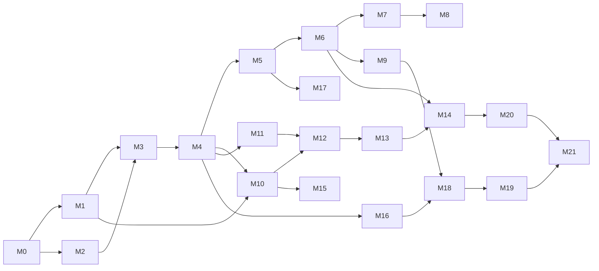

# FlockLake roadmap

FlockLake turns open weather-radar data into quality-checked bird-migration data products. This
roadmap is the plan from an empty repository to v1.0.0. It is organised in six phases and 22
milestones. Every item has an ID (use it in issue titles and commit messages) and an estimate.

- **Estimates** are hours of focused work, including tests and documentation. They are refined
  when a milestone starts.
- **Core plan: 789 hours.** Stretch goals add 135 hours. At 15–20 hours a week, the core plan
  takes about 9–13 months.
- **Order matters.** Phase 2 builds a thin, complete platform on small, already-processed data
  (Aloft profiles). Phase 4 then adds raw radar volumes and FlockLake's own profile engine
  behind the same interfaces. Something useful ships at the end of every phase.
- Background: [architecture](docs/architecture.md), [decisions](docs/adr/),
  [data sources](docs/research/data-sources.md),
  [radar aeroecology](docs/research/radar-aeroecology.md).

## Status

- [x] **Planning**: data sources checked and measured, science notes, target architecture,
  ADRs 0001–0008, this roadmap (2 November 2026).
- [ ] Everything below.

## Overview

| Phase | Milestone | Hours | Release |
| :-- | :-- | --: | :-- |
| 1. Foundations | [M0](#m0--engineering-foundations) Engineering foundations | 37 | v0.1.0 |
| | [M1](#m1--domain-core-library) Domain core library | 51 | |
| 2. First data product | [M2](#m2--local-data-platform) Local data platform | 33 | |
| | [M3](#m3--aloft-profile-ingestion) Aloft profile ingestion | 35 | |
| | [M4](#m4--orchestration-with-dagster) Orchestration with Dagster | 41 | |
| | [M5](#m5--gold-data-products-with-dbt) Gold data products with dbt | 47 | |
| | [M6](#m6--data-quality-and-contracts) Data quality and contracts | 35 | v0.2.0 |
| 3. Public product | [M7](#m7--daily-production-on-github-actions) Daily production on GitHub Actions | 19 | |
| | [M8](#m8--public-dashboard) Public dashboard | 48 | v0.3.0 |
| | [M9](#m9--read-api-and-standards-based-access) Read API and standards-based access | 32 | v0.4.0 |
| 4. From raw radar to birds | [M10](#m10--opera-volume-capture) OPERA volume capture | 40 | |
| | [M11](#m11--nexrad-level-ii-ingestion) NEXRAD Level II ingestion | 22 | |
| | [M12](#m12--vertical-profile-engine) Vertical-profile engine | 84 | v0.5.0 |
| | [M13](#m13--winds-and-flight-behaviour) Winds and flight behaviour | 29 | |
| | [M14](#m14--migration-analytics) Migration analytics | 40 | v0.6.0 |
| 5. Operating it like production | [M15](#m15--event-driven-near-real-time-ingestion) Event-driven near-real-time ingestion | 27 | |
| | [M16](#m16--observability-and-slos) Observability and SLOs | 28 | |
| | [M17](#m17--lineage-and-catalogue) Lineage and catalogue | 18 | v0.7.0 |
| | [M18](#m18--kubernetes-gitops-and-infrastructure-as-code) Kubernetes, GitOps and IaC | 49 | |
| | [M19](#m19--supply-chain-and-release-engineering) Supply chain and release engineering | 22 | v0.8.0 |
| 6. v1.0 | [M20](#m20--documentation-and-validation-report) Documentation and validation report | 29 | |
| | [M21](#m21--hardening-and-v100) Hardening and v1.0.0 | 23 | v1.0.0 |
| | **Core total** | **789** | |
| Later | [Stretch goals](#stretch-goals) | 135 | |

## Definition of done (every item)

- Code, tests and docs land in the same pull request; CI is green.
- New behaviour has tests at the right level (unit, integration or end-to-end).
- Public functions are typed and documented; `mypy --strict` passes.
- A decision with real alternatives gets an ADR.
- New configuration is in `.env.example` with a placeholder; no secrets anywhere.
- New dependencies have a licence on the allow-list (MIT, BSD, Apache-2.0, ISC, MPL-2.0, PSF).
- Only open, non-personal data is used; test fixtures are synthetic and generated by code.
- The item is ticked here, and README.md is updated if the change affects it.

---

## Phase 1: Foundations

### M0 · Engineering foundations

**Goal:** a repository where every later change is linted, typed, tested, documented and released
automatically. **Release:** v0.1.0.

- [ ] **M0.1** uv workspace root and a `flocklake-core` package skeleton (`src/` layout, `py.typed`, Python 3.13 pinned) — *4 h*
- [ ] **M0.2** Shared ruff (lint and format) and `mypy --strict` configuration; both as pre-commit hooks — *3 h*
- [ ] **M0.3** pytest setup: markers (`unit`, `integration`, `e2e`, `slow`), branch coverage with a 90 % gate for core packages, Hypothesis profiles for dev and CI — *3 h*
- [ ] **M0.4** `justfile` with `bootstrap`, `lint`, `typecheck`, `test`, `docs`, `up`, `down` — *2 h*
- [ ] **M0.5** GitHub Actions CI: pre-commit, lint, types, tests on Python 3.13 (3.14 allowed to fail until dependencies support it), uv cache, concurrency groups, per-job least-privilege `permissions`, actions pinned by commit SHA — *6 h*
- [ ] **M0.6** Conventional Commits check on pull-request titles, release-please configuration, first tagged release v0.1.0 with a generated changelog — *3 h*
- [ ] **M0.7** Dependabot for uv, GitHub Actions and Docker, with grouped updates — *2 h*
- [ ] **M0.8** Community files: CONTRIBUTING, CODE_OF_CONDUCT (Contributor Covenant), SECURITY.md, issue forms (bug, feature, new data source), pull-request template, CODEOWNERS, labels — *4 h*
- [ ] **M0.9** `CITATION.cff` and a NOTICE file with data-source attributions — *2 h*
- [ ] **M0.10** Dev container with uv, just, DuckDB CLI and pre-commit — *3 h*
- [ ] **M0.11** Documentation site with Zensical (research notes, architecture, ADRs), built in CI and deployed to GitHub Pages — *4 h*
- [ ] **M0.12** Repository settings: ruleset on `main` (required checks, no force-push, no deletion), secret scanning with push protection, private vulnerability reporting — *1 h*

**Done when:** a pull request with a type error, a failing test or a committed token cannot be
merged; v0.1.0 exists with a changelog; the documentation site is live.

### M1 · Domain core library

**Goal:** the radar physics and data formats as a small, dependency-light, fully tested library
(`flocklake-core`). Everything later builds on it.

- [ ] **M1.1** Typed domain model: radar site (ODIM node, WIGOS id, ICAO, coordinates, antenna height, wavelength, band), quantities, explicit units — *4 h*
- [ ] **M1.2** Reflectivity physics: dBZ ↔ Z ↔ η, η → density with configurable radar cross-section and \|K\|²; vectorised; reproduces the worked example in the science note within 0.2 % — *4 h*
- [ ] **M1.3** Profile integration: VID, VIR, MTR, RTR, MT, density-weighted height and quantiles, direction-specific traffic; documented rules for gaps and missing values — *6 h*
- [ ] **M1.4** Altitude-band overlap weighting for arbitrary bands over 200 m layers; property tests (full range equals total; weights within [0, 1]) — *3 h*
- [ ] **M1.5** Circular statistics (mean direction, resultant length, angular deviation) and wind "from" ↔ movement "to" conversions; tests across the 0°/360° wrap — *3 h*
- [ ] **M1.6** Night calendar: sunset, sunrise and civil twilight per radar (astral); night window per partition date; polar day and night; UTC internally — *5 h*
- [ ] **M1.7** Radar registry: seed file for radars in scope (Aloft, OPERA, NEXRAD metadata) with schema validation and lookups by ODIM, WIGOS and ICAO ids — *4 h*
- [ ] **M1.8** VPTS CSV reader and writer (Arrow/Polars), validated against the official Frictionless table schema (pinned by hash); round-trip tests — *5 h*
- [ ] **M1.9** ODIM HDF5 vertical-profile (vol2bird format) reader and writer — *5 h*
- [ ] **M1.10** Verify, per source, the height reference (sea level or antenna) and direction conventions; record the findings in the method notes — *2 h*
- [ ] **M1.11** Synthetic polar-volume generator: from a known profile and radar geometry, write ODIM volumes (DBZH, VRADH, RHOHV, ZDR) with optional noise, rain cells, clutter and velocity folding. This is the source of all made-up test data — *8 h*
- [ ] **M1.12** API reference (mkdocstrings) and method pages with the formulas — *2 h*

**Done when:** branch coverage is at least 90 %; the physics reproduces real Aloft values; the
synthetic generator writes files that xradar opens without warnings.

---

## Phase 2: First data product

### M2 · Local data platform

**Goal:** one command starts a lakehouse on a laptop.

- [ ] **M2.1** Docker Compose: PostgreSQL (lake catalog and Dagster storage), SeaweedFS (S3), bucket bootstrap job; healthchecks, named volumes, profiles (`core`, `obs`, `lineage`, `api`) — *6 h*
- [ ] **M2.2** DuckLake catalog on PostgreSQL with data on S3; schemas `bronze`, `silver`, `gold`; connection helper reading credentials from the environment — *4 h*
- [ ] **M2.3** One settings model (pydantic-settings) for all packages; a test fails if `.env.example` and the settings drift apart — *3 h*
- [ ] **M2.4** Multi-stage Dockerfile for Python services: uv build stage, slim runtime, non-root user, base image pinned by digest, OCI labels, healthcheck, read-only root filesystem; hadolint in pre-commit — *5 h*
- [ ] **M2.5** Storage accounting per layer (object store and catalog) and a `flocklake budget` report — *4 h*
- [ ] **M2.6** Lake maintenance job: merge small files, expire snapshots, remove orphaned files, apply retention per layer — *4 h*
- [ ] **M2.7** Integration-test harness with testcontainers (PostgreSQL and SeaweedFS), session-scoped — *5 h*
- [ ] **M2.8** `just up`, `just down`, `just reset` (asks for confirmation) — *2 h*

**Done when:** on a fresh clone, `just up` brings a healthy stack up in under two minutes, and
CI integration tests write and read a DuckLake table through the S3 API.

### M3 · Aloft profile ingestion

**Goal:** the first real data, ingested idempotently and inside the storage budget.

- [ ] **M3.1** Anonymous S3 client wrapper (obstore): timeouts, retries with exponential backoff and jitter, a User-Agent naming the project — *3 h*
- [ ] **M3.2** Bucket listings into the bronze manifest (key, size, ETag, last modified, source, licence) with idempotent upserts — *4 h*
- [ ] **M3.3** Change detection from the ETag of `coverage.csv` and per-object ETags; only new or changed objects are fetched — *3 h*
- [ ] **M3.4** Budget planner v1: estimates bytes for a request from the manifest and refuses runs that would exceed the budget, with a clear report; `--dry-run` — *4 h*
- [ ] **M3.5** Downloads verified against size and ETag, written atomically, partial files cleaned up — *3 h*
- [ ] **M3.6** Daily VPTS CSV → validated Arrow (Frictionless and Pandera) → silver `profile` table with provenance columns (`source`, `source_file`, `ingested_at`, `algorithm`) — *6 h*
- [ ] **M3.7** Monthly `.csv.gz` archives for historical seasons, into the same schema — *2 h*
- [ ] **M3.8** CLI: `flocklake ingest aloft --radar nldhl --from 2026-09-01 --to 2026-10-31 --dry-run` (Typer) — *3 h*
- [ ] **M3.9** Tests with recorded listings, small synthetic CSV files and injected failures (timeouts, 5xx responses, truncated files) — *5 h*
- [ ] **M3.10** Weekly live contract test in CI (not on pull requests): the upstream layout and columns still match — *2 h*

**Done when:** two migration seasons for three radars ingest within the budget; a rerun
downloads nothing; the live contract test is green.

### M4 · Orchestration with Dagster

**Goal:** new data arrives without manual steps; backfills are planned and bounded.

- [ ] **M4.1** `flocklake-pipelines` code location with resources for S3, the lake and settings — *4 h*
- [ ] **M4.2** Partitions: radar × night (noon-to-noon UTC with per-region offsets, [ADR 0008](docs/adr/0008-night-partitions.md)); mapping between partition keys and night windows, with tests — *5 h*
- [ ] **M4.3** Assets: Aloft manifest → bronze profile files → silver profiles, with run metadata (rows, bytes, lake snapshot id) — *6 h*
- [ ] **M4.4** Sensor on the ETag of `coverage.csv`, plus a daily fallback schedule; run keys make triggers idempotent — *4 h*
- [ ] **M4.5** Concurrency pools that keep downloads polite; retry policies with backoff; run-queue limits — *3 h*
- [ ] **M4.6** Asset checks wired to the validators from M1 and M3 (blocking or warning) — *4 h*
- [ ] **M4.7** Backfill runbook and `just backfill`: a season split into budget-sized chunks — *3 h*
- [ ] **M4.8** Dagster webserver, daemon and code server in Compose, with PostgreSQL run and event storage — *4 h*
- [ ] **M4.9** Tests: in-process materialisation against a temporary lake, partition mapping, sensor cursors — *6 h*
- [ ] **M4.10** Single-process ephemeral entry point for CI and GitHub Actions — *2 h*

**Done when:** a new Aloft night appears in the lake without manual action; a season backfill
finishes inside the budget; a deliberately corrupted file is stopped by an asset check.

### M5 · Gold data products with dbt

**Goal:** the first data products, tested and documented.

- [ ] **M5.1** dbt project (dbt-core, dbt-duckdb) attached to DuckLake; profiles from the environment; sqlfluff; `dbt build` in CI against a seeded mini-lake — *5 h*
- [ ] **M5.2** Staging and intermediate models: typed, deduplicated, provenance kept — *4 h*
- [ ] **M5.3** `dim_radar` and `dim_night` — *4 h*
- [ ] **M5.4** `fct_profile_integrated`: VID, VIR, MTR, RTR, mean height, height quantiles — *6 h*
- [ ] **M5.5** `fct_band_traffic` with overlap weighting and bands defined as seed data — *4 h*
- [ ] **M5.6** `fct_night_summary`: MT, peak MTR and its time after sunset, mean direction and concentration — *6 h*
- [ ] **M5.7** Enforced model contracts on every mart; generic tests (unique, not null, accepted ranges, relationships) — *4 h*
- [ ] **M5.8** dbt unit tests for each formula, cross-checked against `flocklake-core` on the same input — *5 h*
- [ ] **M5.9** Incremental builds per night partition; reruns are idempotent — *3 h*
- [ ] **M5.10** dagster-dbt: models as partitioned assets with declarative automation — *4 h*
- [ ] **M5.11** dbt docs and exposures (dashboard and API) — *2 h*

**Done when:** `dbt build` passes in CI; the SQL and Python implementations of MTR agree to a
relative 1e-9 on the same input; rerunning a night changes nothing.

### M6 · Data quality and contracts

**Goal:** every gold product has a contract and every failure class has a check.
**Release:** v0.2.0, "first data product".

- [ ] **M6.1** ODCS v3.1 data contracts for every gold product: schema, quality rules, service levels, owner, licence and attribution — *6 h*
- [ ] **M6.2** `datacontract lint` and `test` in CI against the mini-lake; pull requests that break a contract fail unless its major version changes — *4 h*
- [ ] **M6.3** Completeness: expected versus received profiles per night, from scan cadence and night length — *4 h*
- [ ] **M6.4** Physics checks: `ff` consistent with `u` and `v`, direction range, height grid, non-negative density — *3 h*
- [ ] **M6.5** Contamination indicators: precipitation share (`dbz_all` versus `dbz`), gap share, low-layer reliability — *4 h*
- [ ] **M6.6** `dq_scorecard` per radar-night, with flags carried into gold rows — *4 h*
- [ ] **M6.7** Quarantine for failed batches (kept and queryable, excluded from gold) and a replay command — *4 h*
- [ ] **M6.8** Freshness policies per product and a failure notification hook — *3 h*
- [ ] **M6.9** VPTS CSV export validated against the official schema — *2 h*
- [ ] **M6.10** Release notes and the v0.2.0 tag — *1 h*

**Done when:** each failure class in the [quality strategy](docs/architecture.md#8-data-quality-strategy)
has a test that triggers it, and contract-breaking changes fail CI.

---

## Phase 3: Public product

### M7 · Daily production on GitHub Actions

**Goal:** the public data updates every day with no server to run.

- [ ] **M7.1** Scheduled workflow after 03:30 UTC: run the Aloft slice for the configured radars with the ephemeral Dagster entry point, then `dbt build` — *6 h*
- [ ] **M7.2** Publish gold extracts (Parquet, VPTS CSV) to a rolling `data-latest` release; data is never committed to Git — *3 h*
- [ ] **M7.3** Guards: fail above a size or time limit; concurrency control; artifact retention — *3 h*
- [ ] **M7.4** On failure, open or update one tracking issue with the run link and the failing check; close it on the next success — *3 h*
- [ ] **M7.5** Freshness badge (Shields endpoint JSON) and pipeline badge in the README — *2 h*
- [ ] **M7.6** Runbook: rerun, fill a missed night, change the radar list — *2 h*

**Done when:** 14 consecutive days of unattended runs; a forced failure opens exactly one issue
and the next success closes it.

### M8 · Public dashboard

**Goal:** anyone can see last night's migration in a browser. **Release:** v0.3.0.

- [ ] **M8.1** Vite and TypeScript scaffold (strict), ESLint, Prettier, Vitest — *4 h*
- [ ] **M8.2** Data layer: DuckDB-WASM over the published Parquet extracts; typed queries; caching — *5 h*
- [ ] **M8.3** Radar map (MapLibre GL JS) coloured by last night's migration traffic — *5 h*
- [ ] **M8.4** Time–height plot: bird density over altitude and time with speed and direction arrows — *8 h*
- [ ] **M8.5** Night panel: MTR curve, migration traffic, peak timing, altitude distribution, direction rose — *6 h*
- [ ] **M8.6** Season view: cumulative passage, phenology percentiles, band-traffic calendar — *5 h*
- [ ] **M8.7** Quality overlay: flags and scorecard next to every chart — *3 h*
- [ ] **M8.8** Accessibility (WCAG 2.2 AA), colour-blind-safe palettes, keyboard navigation, dark mode — *4 h*
- [ ] **M8.9** Playwright end-to-end and visual regression tests; Lighthouse CI budgets — *5 h*
- [ ] **M8.10** Attribution footer and an "about the data" page; deployment to GitHub Pages; preview builds for pull requests — *3 h*

**Done when:** the dashboard updates daily from M7, passes automated accessibility checks, and
meets its Lighthouse performance budget on a mobile profile.

### M9 · Read API and standards-based access

**Goal:** programmatic access through a documented API and an OGC standard. **Release:** v0.4.0.

- [ ] **M9.1** FastAPI service over the gold layer (read-only DuckDB): `/radars`, `/radars/{id}/nights`, `/profiles`, `/traffic`, `/summaries` — *8 h*
- [ ] **M9.2** Pagination, filtering, ETags and conditional requests, cache headers, RFC 9457 problem details — *4 h*
- [ ] **M9.3** Exports: VPTS CSV, Parquet, GeoJSON (radars), each carrying attribution metadata — *3 h*
- [ ] **M9.4** OGC API – EDR through pygeoapi: position queries that return profile time series per radar — *8 h*
- [ ] **M9.5** Schemathesis property-based tests against the OpenAPI document in CI — *3 h*
- [ ] **M9.6** Container, healthchecks, rate limiting, CORS, structured access logs — *3 h*
- [ ] **M9.7** Locust load test; p95 latency target documented — *3 h*

**Done when:** the OpenAPI 3.1 document is published with the docs; Schemathesis reports no
failures; the EDR endpoint passes the applicable OGC conformance tests.

---

## Phase 4: From raw radar to birds

### M10 · OPERA volume capture

**Goal:** capture European polar volumes before the 24-hour cache expires, inside the budget.

- [ ] **M10.1** Listing of `openradar-24h` by date, country and radar; key parser for `{radar}@{time}@{elevations}@{quantities}.h5`; both packaging shapes (all quantities in one file, or one file per quantity) — *5 h*
- [ ] **M10.2** Spike: byte-range reads of remote ODIM HDF5 (h5py over fsspec/obstore) for selected quantities and elevations; measure bytes and time against full downloads; ADR 0009 — *8 h*
- [ ] **M10.3** Capture schedule (hourly in night windows) with its own freshness check and alert — *4 h*
- [ ] **M10.4** ODIM conformance validator: required groups and attributes, gain/offset/nodata/undetect, elevation order — *5 h*
- [ ] **M10.5** Normalise with xradar and write silver Zarr v3 (chunked per sweep, consolidated metadata) — *6 h*
- [ ] **M10.6** STAC items for captured volumes (radar, time, quantities, elevations, licence) — *4 h*
- [ ] **M10.7** ORD API client (EDR items and locations) as a second discovery path, honouring `x-ratelimit-remaining` — *4 h*
- [ ] **M10.8** Tests with synthetic ODIM files from M1.11 and recorded listings — *4 h*

**Done when:** a full night from both Dutch radars at 15-minute sampling is captured inside the
bronze ceiling, and the byte savings are measured and recorded in ADR 0009.

### M11 · NEXRAD Level II ingestion

**Goal:** a second radar band, format and continent, through the same silver schema.

- [ ] **M11.1** Listing of `unidata-nexrad-level2` per site and date; `_MDM` files skipped; manifest rows — *3 h*
- [ ] **M11.2** Download and decode with xradar; volume coverage patterns with repeated low sweeps (SAILS, MESO-SAILS), split cuts, super-resolution — *8 h*
- [ ] **M11.3** Normalise to the same silver polar-volume schema as OPERA (ODIM quantity names) — *5 h*
- [ ] **M11.4** Delete raw files after silver is written; rehydrate from the manifest on demand — *2 h*
- [ ] **M11.5** Integration tests on a real sample cached in CI (downloaded, never committed) — *4 h*

**Done when:** one night of KDOX lands in silver, and downstream code reads European and US
volumes without branching on the source.

### M12 · Vertical-profile engine

**Goal:** FlockLake computes bird profiles from raw volumes itself, transparently, and proves
they are right. **Release:** v0.5.0.

- [ ] **M12.1** Method specification: inputs, steps, parameters, defaults with citations, outputs, and agreement targets for validation — *6 h*
- [ ] **M12.2** Gate selection and layering: range limits, elevation choice, beam height with the 4/3 Earth model, 200 m layers — *6 h*
- [ ] **M12.3** Precipitation and clutter screening: ρHV and depolarisation ratio (dual-pol), reflectivity cells with fringe (single-pol), static clutter maps — *12 h*
- [ ] **M12.4** VVP retrieval per layer: least squares, residual standard deviation, azimuth-coverage gap test — *8 h*
- [ ] **M12.5** Velocity dealiasing by torus mapping — *10 h*
- [ ] **M12.6** Reflectivity to density with band-specific `sd_vvp` thresholds; insect flags — *4 h*
- [ ] **M12.7** Synthetic-truth suite: recover known profiles from generated volumes under noise, rain, clutter and folding (Hypothesis) — *8 h*
- [ ] **M12.8** Differential tests against vol2bird in a container (MistNet disabled) on sampled real volumes; tolerance report per quantity — *10 h*
- [ ] **M12.9** Reconciliation with Aloft profiles for the same radar and time; agreement metrics published — *4 h*
- [ ] **M12.10** Performance: vectorised hot paths, optional Numba; pytest-benchmark baselines in CI — *6 h*
- [ ] **M12.11** Outputs in VPTS CSV and ODIM profile HDF5; round-trip test that reads FlockLake output with bioRad in an R container in CI — *6 h*
- [ ] **M12.12** Dagster assets from volume to profile per radar-night, feeding the existing gold models unchanged — *4 h*

**Done when:** synthetic truth is recovered within the tolerances of M12.1; on real nights, the
differences to vol2bird and Aloft meet the agreement targets and are published; bioRad reads
the output.

### M13 · Winds and flight behaviour

**Goal:** separate what birds do from what the wind does to them.

- [ ] **M13.1** Open-Meteo client: pressure-level winds and geopotential per radar and hour; cache; attribution — *4 h*
- [ ] **M13.2** Interpolation to layer midpoints by geopotential height; tests against analytic profiles — *4 h*
- [ ] **M13.3** Airspeed, heading, tailwind and crosswind, with direction conventions tested — *4 h*
- [ ] **M13.4** `fct_flight_behaviour` and nightly aggregates (flow assistance, drift indicators) — *6 h*
- [ ] **M13.5** Optional ERA5 path through the Copernicus CDS API (key in `.env`) for historical seasons — *5 h*
- [ ] **M13.6** Insect flag from airspeed (reported, not removed) — *2 h*
- [ ] **M13.7** Dashboard panel: wind against flight direction by altitude — *4 h*

**Done when:** flight-behaviour products exist for every night with profiles, and the vector
maths is covered by property tests.

### M14 · Migration analytics

**Goal:** descriptive products that answer ecological and applied questions. **Release:** v0.6.0.

- [ ] **M14.1** Phenology: cumulative passage per season; 5, 50 and 95 % passage dates — *5 h*
- [ ] **M14.2** Multi-year baselines from Aloft monthly archives (median and MAD per week of year), within budget — *6 h*
- [ ] **M14.3** Night-level anomaly flags (robust z-scores against the baseline) — *3 h*
- [ ] **M14.4** Rotor-band exceedance events: configurable thresholds (default 500 birds/km/h at 25–300 m) and seasonal windows as seed data; caveats in every output — *6 h*
- [ ] **M14.5** North Sea flyway overview: the same night across radars, with timing differences — *5 h*
- [ ] **M14.6** Spatial density maps per radar from profiles (integrate-to-PPI approach, Kranstauber et al. 2020), one radar first — *10 h*
- [ ] **M14.7** Contracts, tests and dashboard pages for each product — *5 h*

**Done when:** each product has a contract, tests and a dashboard page, and every exceedance
output states that it is retrospective and not an operational signal.

---

## Phase 5: Operating it like production

### M15 · Event-driven near-real-time ingestion

**Goal:** profiles minutes after the radar scans, not hours.

- [ ] **M15.1** MQTT bridge for OPERA notifications: reconnects with backoff, topic filters per radar, at-least-once delivery — *6 h*
- [ ] **M15.2** Transactional inbox in PostgreSQL, idempotent by object key, with a dead-letter table — *4 h*
- [ ] **M15.3** Dagster sensor on the inbox; latency metric from scan time to profile available — *4 h*
- [ ] **M15.4** Optional NEXRAD SNS → SQS path provisioned with OpenTofu, with a polling fallback — *8 h*
- [ ] **M15.5** Replay tool and load test with a recorded notification stream — *4 h*
- [ ] **M15.6** ADR 0010: an inbox table instead of a message broker at this volume — *1 h*

**Done when:** over one night, p95 latency from upstream object to silver profile stays under
the target set in ADR 0010, and duplicate notifications create no duplicate rows.

### M16 · Observability and SLOs

**Goal:** problems are seen before users see them.

- [ ] **M16.1** structlog JSON logs with run, asset, partition and trace ids on every line — *4 h*
- [ ] **M16.2** OpenTelemetry traces for HTTP, S3 and database calls; collector in Compose — *5 h*
- [ ] **M16.3** Prometheus metrics: bytes fetched and avoided, objects, latency, budget use, check outcomes, freshness lag — *5 h*
- [ ] **M16.4** Grafana dashboards as code, Loki for logs — *6 h*
- [ ] **M16.5** SLOs with error budgets (freshness, success rate, OPERA capture completeness) and alert rules linked to runbooks — *5 h*
- [ ] **M16.6** Game day: break an upstream, fill the disk, stop the catalog; confirm alerts and recovery — *3 h*

**Done when:** every alert has a runbook and fired during the game day; dashboards show each SLO
and its remaining error budget.

### M17 · Lineage and catalogue

**Goal:** any number can be traced to its sources. **Release:** v0.7.0.

- [ ] **M17.1** OpenLineage events from Dagster and dbt to Marquez (Compose profile) — *6 h*
- [ ] **M17.2** Column-level lineage for gold marts, documented — *3 h*
- [ ] **M17.3** Static STAC catalogue of volumes and products, validated in CI and published with the docs — *5 h*
- [ ] **M17.4** Data dictionary generated from contracts and dbt docs — *4 h*

**Done when:** a gold value can be followed back to the upstream object keys in the lineage UI.

### M18 · Kubernetes, GitOps and infrastructure as code

**Goal:** the same platform on a production-like cluster, declared in Git.

- [ ] **M18.1** kind cluster configuration with ingress and a local registry; `just k8s-up` — *3 h*
- [ ] **M18.2** Helm umbrella chart: Dagster (official chart, Kubernetes run launcher), CloudNativePG, SeaweedFS, API, MQTT bridge — *12 h*
- [ ] **M18.3** Restricted pod security, resource requests and limits, NetworkPolicies, PodDisruptionBudgets — *5 h*
- [ ] **M18.4** Secrets with SOPS and age; nothing in plain text in Git — *3 h*
- [ ] **M18.5** Argo CD app-of-apps syncing from the repository; environments as values files — *6 h*
- [ ] **M18.6** CI: helm lint, kubeconform, chart-testing install on kind — *5 h*
- [ ] **M18.7** OpenTofu: GitHub repository settings, rulesets and labels as code; kind cluster; buckets — *8 h*
- [ ] **M18.8** Optional cloud deployment module, documented with cost notes, not applied by default — *3 h*
- [ ] **M18.9** Upgrade and rollback drill; catalog backup and restore (CloudNativePG backups to S3) — *4 h*

**Done when:** a commit to `main` changes the cluster through Argo CD only, and a restore from
backup is rehearsed and documented.

### M19 · Supply chain and release engineering

**Goal:** anyone can verify what they run. **Release:** v0.8.0.

- [ ] **M19.1** Multi-architecture images (amd64, arm64) with BuildKit cache, published to GHCR — *4 h*
- [ ] **M19.2** SBOMs with syft, attached to releases and images — *2 h*
- [ ] **M19.3** Keyless signing with cosign and GitHub artifact attestations; verification in the deploy path — *5 h*
- [ ] **M19.4** release-please per component (core, pipelines, API, web, chart, contracts); semantic versioning for data contracts — *4 h*
- [ ] **M19.5** Zenodo DOI for releases; `CITATION.cff` kept in sync — *2 h*
- [ ] **M19.6** OpenSSF Scorecard workflow and badge; findings addressed — *3 h*
- [ ] **M19.7** Dependency licence check in CI against the allow-list — *2 h*

**Done when:** a release's images verify with `cosign` and `gh attestation verify`, and its
SBOM and DOI are linked from the release page.

---

## Phase 6: v1.0

### M20 · Documentation and validation report

- [ ] **M20.1** Tutorials: run locally in 10 minutes; add a radar; backfill a season; export to bioRad — *8 h*
- [ ] **M20.2** A runbook for every alert — *4 h*
- [ ] **M20.3** Method validation report: synthetic-truth and reconciliation results, known limitations — *8 h*
- [ ] **M20.4** Case study: autumn 2026 over the North Sea, built entirely from the platform's products — *5 h*
- [ ] **M20.5** C4 diagrams, ADR index, and every bibliography entry checked against its DOI — *4 h*

**Done when:** a new user follows the first tutorial on a fresh machine without help.

### M21 · Hardening and v1.0.0

- [ ] **M21.1** Failure-mode tests: corrupted HDF5, truncated downloads, catalog unavailable, object store full; recovery is idempotent — *8 h*
- [ ] **M21.2** Mutation testing (mutmut) on `flocklake-core` and the profile engine, raised to the target kill rate — *6 h*
- [ ] **M21.3** Performance and cost report: bytes per night per source, run time per stage — *3 h*
- [ ] **M21.4** Configuration review: least privilege, defaults, secrets handling, CORS, rate limits — *3 h*
- [ ] **M21.5** Release checklist, upgrade notes, v1.0.0 — *3 h*

**Done when:** all success metrics below are met and v1.0.0 is tagged.

---

## Stretch goals

- [ ] **S1** More OPERA countries, with packaging adapters per national format — *15 h*
- [ ] **S2** Multi-radar composite maps of bird density (deterministic mosaicking of per-radar maps) — *30 h*
- [ ] **S3** Edge radar node: a low-cost 24 or 60 GHz radar module streaming target summaries into the platform; simulator first, then hardware — *40 h*
- [ ] **S4** Python and R client packages for the API — *20 h*
- [ ] **S5** Apache Iceberg export of gold tables for external engines — *10 h*
- [ ] **S6** Light-pollution context: heavy-migration nights against public night-time light data — *20 h*

## Success metrics for v1.0

| Metric | Target |
| :-- | :-- |
| Fresh clone to running demo | ≤ 10 minutes with `just up` and `just demo` |
| Daily public product on time | ≥ 95 % of days in a season, by 10:00 UTC |
| Storage budget | Never exceeded (enforced by the planner) |
| Profile engine agreement with vol2bird/Aloft | Targets from M12.1 met on ≥ 90 % of sampled night-hours |
| Test coverage (branches) | ≥ 90 % for `flocklake-core` and the profile engine |
| Mutation kill rate | ≥ 70 % for the same packages |
| Secrets in history | Zero findings (gitleaks, GitHub secret scanning) |
| Supply chain | Every release image signed, attested and with an SBOM |

## Risks

| Risk | Likelihood | Impact | Mitigation |
| :-- | :-- | :-- | :-- |
| Upstream layout or access changes (NEXRAD moved buckets in 2025) | Medium | High | Source adapters behind interfaces; weekly live contract tests; manifests record what was seen |
| OPERA nights lost because nothing ran within 24 hours | High | Medium | Freshness alert on capture; after M12, a GitHub Actions capture job that stores profiles only; gaps recorded explicitly |
| Byte-range reads slower than whole downloads | Medium | Medium | Spike first (M10.2); fall back to download-process-delete |
| Own profile engine disagrees with vol2bird | Medium | High | Synthetic truth first, differential tests, documented deviations; Aloft stays the default source until targets are met |
| Backfills exceed the storage budget | Medium | Medium | Planner refuses; chunked backfills |
| Tool churn (Zensical before 1.0, a young DuckLake, consolidation around dbt) | Medium | Medium | "Revisit when" triggers in ADRs; thin adapters; pinned versions |
| Exceedance events read as curtailment advice | Medium | High | Caveats in data, API, dashboard and docs; no forecasts |
| Rate limits on the ORD API | Medium | Low | S3 is the primary path; headers honoured |
| Scope creep | High | Medium | Releases gate phases; stretch goals kept separate |

## Out of scope

- Forecasting migration, and any learned or trained model ([ADR 0003](docs/adr/0003-physics-based-processing.md)).
- Operational wind-farm curtailment or aviation-safety decisions.
- Species identification.
- User accounts, personal data, and citizen-science observation records.
- Mirroring radar archives in bulk.

## Tracking

Every item is a GitHub issue titled with its ID (for example `M3.4 Budget planner v1`), in a
GitHub milestone per roadmap milestone:
[milestones](https://github.com/soheil-mp/flocklake/milestones) ·
[open roadmap issues](https://github.com/soheil-mp/flocklake/issues?q=is%3Aissue+is%3Aopen+label%3Aroadmap).

- Labels: `roadmap`; an area (`area:devex`, `area:science`, `area:platform`, `area:ingest`,
  `area:orchestration`, `area:transform`, `area:quality`, `area:ops`, `area:web`, `area:api`,
  `area:docs`, `area:stretch`); and a size (`size:S` up to 2 h, `size:M` 3–5 h, `size:L` 6–8 h,
  `size:XL` 10 h or more).
- A pull request that finishes an item closes its issue (`Closes #N`) and ticks the item here.
- New work found along the way gets an issue first, then a line here if it changes a milestone's
  scope or estimate.
