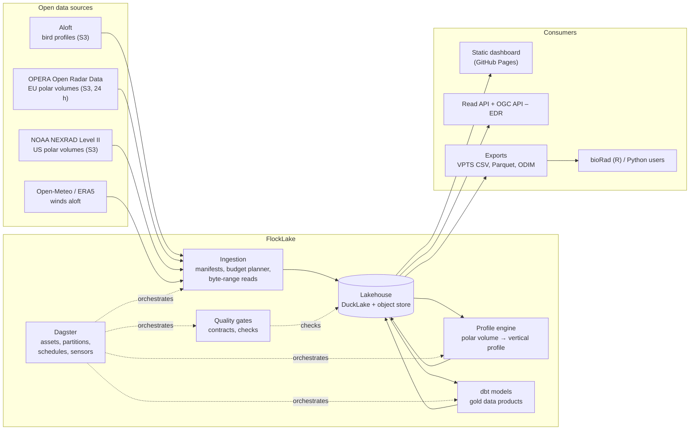
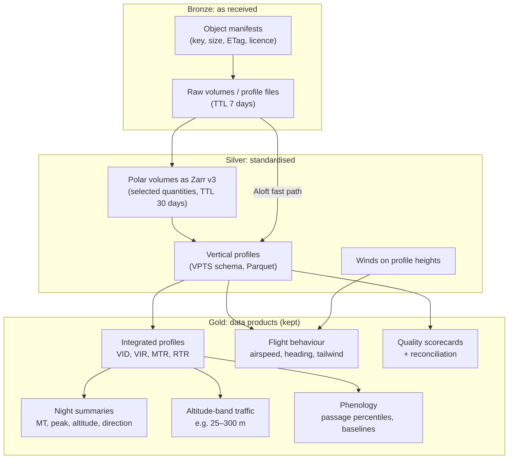

# Architecture

This is the target architecture that [ROADMAP.md](../ROADMAP.md) builds towards. Decisions with
real alternatives are recorded as ADRs in [docs/adr](adr/). Anything marked *planned* does not
exist yet.

## 1. Goals and quality attributes

| Attribute | What it means here | How it is checked |
| :-- | :-- | :-- |
| **Interpretable** | Every number traces to a formula, a threshold and an input file | Physics-based code only ([ADR 0003](adr/0003-physics-based-processing.md)); lineage; method docs |
| **Correct** | Profiles agree with the reference algorithm and with synthetic truth | Synthetic-truth tests, differential tests against vol2bird, reconciliation with Aloft |
| **Reproducible** | The same inputs and version give the same outputs, bit for bit where possible | Locked dependencies, pinned image digests, lake snapshots recorded per run |
| **Budget-aware** | Runs on a laptop with a few GB of disk | Storage budget enforced before download ([ADR 0007](adr/0007-storage-budget-and-manifest-first-ingestion.md)) |
| **Observable** | Freshness, failures and bytes are visible and alerting | Asset checks, metrics, SLOs, dashboards |
| **Portable** | The same code runs in three places | Docker Compose, Kubernetes (kind), GitHub Actions |
| **Open** | Open data in, open standards out | VPTS CSV, ODIM HDF5, Parquet, STAC, OGC API – EDR, ODCS contracts |

## 2. System context



## 3. Data flow and layers



- **Bronze** keeps a manifest row for every upstream object FlockLake has seen, whether or not it
  was downloaded. Archives that never expire (Aloft, NEXRAD) can be fetched again from the
  manifest at any time, so raw bytes are short-lived. OPERA's cache expires after 24 hours, so
  OPERA volumes are processed within that window.
- **Silver** holds standardised arrays (Zarr) and tables (Parquet in DuckLake). Profiles from any
  source share one schema: the VPTS CSV fields plus provenance columns.
- **Gold** holds small, contract-backed data products that are kept indefinitely.

## 4. Planned repository layout

```text
flocklake/
├── packages/                    # uv workspace members (Python)
│   ├── flocklake-core/          # physics, units, formats (VPTS CSV, ODIM), night calendar
│   ├── flocklake-ingest/        # source clients, manifests, budget planner, byte-range reads
│   ├── flocklake-vp/            # vertical-profile engine (polar volume → profile)
│   ├── flocklake-pipelines/     # Dagster code location: assets, partitions, sensors, checks
│   └── flocklake-api/           # FastAPI read service and pygeoapi configuration
├── transform/                   # dbt project (dbt-duckdb on DuckLake)
├── contracts/                   # ODCS data contracts for every gold product
├── web/                         # static dashboard (Vite + TypeScript + DuckDB-WASM)
├── infra/
│   ├── docker/                  # Dockerfiles
│   ├── compose/                 # Docker Compose profiles
│   ├── helm/                    # umbrella chart
│   ├── argocd/                  # GitOps application definitions
│   ├── tofu/                    # OpenTofu modules
│   └── observability/           # OpenTelemetry collector, Prometheus, Grafana, Loki
├── tests/                       # cross-package integration and end-to-end tests
├── docs/                        # documentation site, ADRs, runbooks, research
├── .github/                     # workflows, templates, Dependabot
├── justfile                     # task runner entry points
└── pyproject.toml               # workspace root
```

`flocklake-core` has no network or service dependencies, so the science can be tested in
isolation and reused by other projects.

## 5. Gold data model (planned)

| Table | Grain | Key columns | Notes |
| :-- | :-- | :-- | :-- |
| `dim_radar` | radar | `radar_id` (ODIM node or ICAO), `wigos_id` | Coordinates, antenna height, wavelength, band, network, data licence |
| `dim_night` | radar × night | `radar_id`, `night_date` | Sunset/sunrise UTC, civil twilight, night length, polar-day flag |
| `fct_profile` | radar × time × layer | `radar_id`, `datetime`, `height` | VPTS fields + `source`, `algorithm`, `algorithm_version`, `rcs` |
| `fct_profile_integrated` | radar × time | `radar_id`, `datetime` | VID, VIR, MTR, RTR, mean height, height quantiles |
| `fct_band_traffic` | radar × time × band | `radar_id`, `datetime`, `band_id` | Overlap-weighted traffic in configurable altitude bands |
| `fct_night_summary` | radar × night | `radar_id`, `night_date` | MT, peak MTR and its time after sunset, mean direction and concentration |
| `fct_flight_behaviour` | radar × time × layer | `radar_id`, `datetime`, `height` | Wind, airspeed, heading, tailwind, crosswind |
| `fct_phenology` | radar × season | `radar_id`, `season` | Cumulative passage, 5/50/95 % passage dates, baseline comparison |
| `fct_exceedance_event` | radar × event | `radar_id`, `event_id` | Contiguous hours above a band-traffic threshold, with caveats |
| `fct_reconciliation` | radar × time | `radar_id`, `datetime` | FlockLake profile vs Aloft reference: differences per quantity |
| `dq_scorecard` | radar × night | `radar_id`, `night_date` | Completeness, gap share, precipitation share, check outcomes |

Quality problems are stored as **flags**, never as silent deletions, so every gold row can say
why it should or should not be trusted.

## 6. Partitions and scheduling (planned)

| Asset group | Partitioning | Trigger | Why |
| :-- | :-- | :-- | :-- |
| Aloft profiles | radar × night | Sensor on the ETag of `coverage.csv`, plus a daily schedule after 03:00 UTC as a fallback | The bucket is refreshed nightly around 02:30 UTC |
| OPERA volumes | radar × night | Hourly schedule during the night window; MQTT notifications later (M15) | The cache only holds 24 hours |
| NEXRAD volumes | radar × night | Daily schedule for the previous night; SNS→SQS optional (M15) | The archive is permanent, so batch is enough |
| Winds | radar × night | After the night ends | Reanalysis and analysis fields settle after the fact |
| dbt gold models | radar × night | Declarative automation when upstream assets change | Rebuild only what changed |
| Maintenance | none | Weekly | Compaction, snapshot expiry, TTL cleanup, budget report |

Night partitions are explained in [ADR 0008](adr/0008-night-partitions.md).

## 7. Storage budget (default 2 GB)

| Layer | Target ceiling | Retention | Typical content |
| :-- | :-- | :-- | :-- |
| Bronze raw | 1.0 GB | 7 days | One sampled night of one radar (~48 volumes) |
| Silver arrays | 0.5 GB | 30 days | Subset quantities and elevations as Zarr |
| Silver/gold tables | 0.4 GB | Kept | Several radars × two migration seasons of profiles |
| Catalog, metadata, logs | 0.1 GB | Rolling | Postgres catalog, STAC, run logs |

These are design targets. Milestones M3 and M10 measure real sizes and adjust them. The planner
refuses a run that would exceed the budget and says by how much.

## 8. Data quality strategy

Checks run at every boundary, from cheap to expensive:

1. **Transport:** size and ETag match the manifest; checksums verified; partial downloads
   discarded.
2. **Format:** ODIM conformance (required `what/where/how` attributes, gain/offset/nodata/undetect
   per quantity); VPTS CSV validated against the official Frictionless table schema.
3. **Schema:** Pandera models on DataFrames; dbt model contracts on tables; ODCS contracts on gold
   products (checked in CI with `datacontract test`).
4. **Physics:** plausible ranges (density ≥ 0, ground speed < 50 m/s, heights on the 200 m grid,
   direction in [0, 360)), and consistency (`ff` equals `√(u² + v²)`).
5. **Completeness:** expected versus received scans per night, derived from the scan cadence and
   night length.
6. **Cross-source reconciliation:** FlockLake profiles against Aloft's vol2bird profiles for the
   same radar and time, with tolerances per quantity.
7. **Freshness:** service levels per product (for example: gold for night *N* exists by 10:00
   UTC on day *N+1*).

Dagster asset checks run these and block downstream assets on errors (warnings only flag).

## 9. Deployment topologies

| Mode | Use | Components |
| :-- | :-- | :-- |
| **Laptop** (`just up`) | Development and demos | Docker Compose: PostgreSQL, SeaweedFS (S3), Dagster webserver + daemon + code server, API; optional observability and lineage profiles |
| **Kubernetes** | Production-like rehearsal | kind cluster, Helm umbrella chart, Dagster official chart with the Kubernetes run launcher, CloudNativePG, Argo CD for GitOps, SOPS-encrypted secrets |
| **Serverless daily** | The public demo | GitHub Actions cron runs the Aloft slice with an ephemeral Dagster instance, publishes small Parquet extracts and rebuilds the GitHub Pages dashboard |

## 10. Security and compliance

- No secrets in the repository: configuration from environment variables; gitleaks before every
  commit and in CI; GitHub secret scanning with push protection.
- Least privilege: workflow `permissions` set per job; OIDC instead of long-lived registry tokens;
  containers run as non-root with read-only root filesystems.
- Supply chain: dependencies locked (`uv.lock`), GitHub Actions pinned by commit SHA, images
  pinned by digest, SBOMs, signed images and build provenance attestations (M19).
- Data: only open, non-personal data; licences and attribution carried in metadata and exports
  ([data sources](research/data-sources.md)).
- No accounts: the API and dashboard are read-only and anonymous.

## 11. Tool choices

| Area | Choice | Licence | Main alternatives considered |
| :-- | :-- | :-- | :-- |
| Language and packaging | Python 3.13, uv workspace | PSF; MIT/Apache-2.0 | Poetry, pip-tools |
| Lint, format, types | ruff, mypy (strict) | MIT | pyright; Astral's `ty` once stable |
| Tests | pytest, Hypothesis, testcontainers, mutmut | MIT, MPL-2.0, Apache-2.0, BSD-3 | — |
| Radar I/O and arrays | xradar, xarray, h5py, NumPy, Zarr v3 | MIT, Apache-2.0, BSD-3, BSD-3, MIT | wradlib, Py-ART (kept for reference algorithms) |
| Sun and night | astral | Apache-2.0 | skyfield |
| Object access | obstore, fsspec | MIT/Apache-2.0, BSD-3 | boto3 |
| Tables and SQL | DuckDB, DuckLake 1.0, Polars, PyArrow | MIT, MIT, MIT, Apache-2.0 | Apache Iceberg + Lakekeeper ([ADR 0005](adr/0005-lakehouse-ducklake-postgres-s3.md)) |
| Object store (local) | SeaweedFS | Apache-2.0 | MinIO (community edition archived Feb 2026), RustFS, Garage |
| Orchestration | Dagster OSS | Apache-2.0 | Airflow 3, Prefect 3 ([ADR 0004](adr/0004-orchestration-dagster.md)) |
| Transformation | dbt-core + dbt-duckdb, sqlfluff | Apache-2.0, MIT | SQLMesh; dbt Fusion (Elastic Licence 2.0, not open source) ([ADR 0006](adr/0006-transformations-dbt-core.md)) |
| Validation and contracts | Pandera, Frictionless, datacontract-cli (ODCS v3.1) | MIT | Great Expectations, Soda Core |
| Lineage and catalogue | OpenLineage, Marquez, STAC (pystac) | Apache-2.0 | DataHub, OpenMetadata |
| Serving | FastAPI, pydantic, pygeoapi (OGC API – EDR) | MIT | Litestar |
| API testing | Schemathesis, Locust | MIT | — |
| CLI, config, logs | Typer, pydantic-settings, structlog | MIT, MIT, MIT/Apache-2.0 | Click |
| Observability | OpenTelemetry, Prometheus, Grafana, Loki | Apache-2.0, Apache-2.0, AGPL-3.0 (service), AGPL-3.0 (service) | — |
| Containers and Kubernetes | Docker BuildKit, Compose, kind, Helm, Argo CD, CloudNativePG | Apache-2.0 | k3d, Flux, Kustomize |
| Secrets in Git | SOPS + age | MPL-2.0, BSD-3 | Sealed Secrets |
| Infrastructure as code | OpenTofu | MPL-2.0 | Terraform (BUSL-1.1, not open source) |
| CI/CD and releases | GitHub Actions, Dependabot, release-please | Apache-2.0 (release-please) | Renovate, semantic-release |
| Supply chain | syft (SBOM), cosign, GitHub artifact attestations, OpenSSF Scorecard | Apache-2.0 | — |
| Docs | Zensical, mkdocstrings | MIT, ISC | Material for MkDocs (maintenance mode since Nov 2025), Sphinx |
| Task runner | just | CC0-1.0 | Make |
| Dashboard | Vite, TypeScript, DuckDB-WASM, Observable Plot, MapLibre GL JS, Playwright | MIT, Apache-2.0, MIT, ISC, BSD-3, Apache-2.0 | Evidence, Streamlit |
| Reference implementations (tests only) | vol2bird (MistNet disabled), bioRad in an R container | MIT | — |

Services under AGPL (Grafana, Loki) run as separate, unmodified containers and are never imported
or vendored, which keeps the MIT licence of this code intact.
